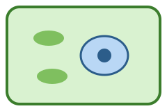

{{nyml
kind: document
carrier: md
uid: doc-bio101lesson01
title: Lesson 1 · What is a cell?
description: Cell theory, prokaryotes and eukaryotes, and how big cells are.
date: 2026-09-02
}}

# Lesson 1 · What is a cell?

{{md ../shared/objectives-1.md}}

## Cell theory

1. All living things are made of one or more cells.
2. The cell is the basic unit of life.
3. Every cell comes from an existing cell.

## Sizes

A typical animal cell is about $10\,\mu\text{m}$ across; a bacterium about
$1\,\mu\text{m}$. The ratio of surface area to volume, $A/V = 6/d$ for a cube
of side $d$, limits how large a cell can grow.

Next: [Membranes](02-membranes.md). The slides for this week:
[Week 1](../slides/week1.slides.md). Back to the [course home](../index.md).
